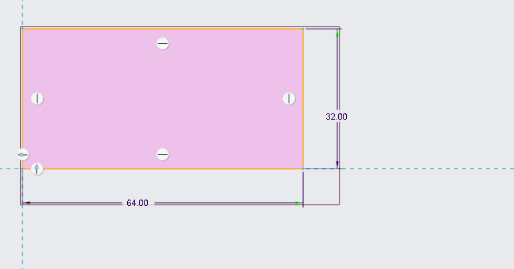
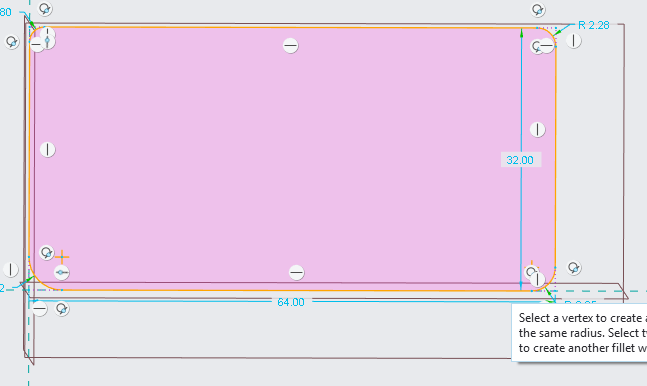
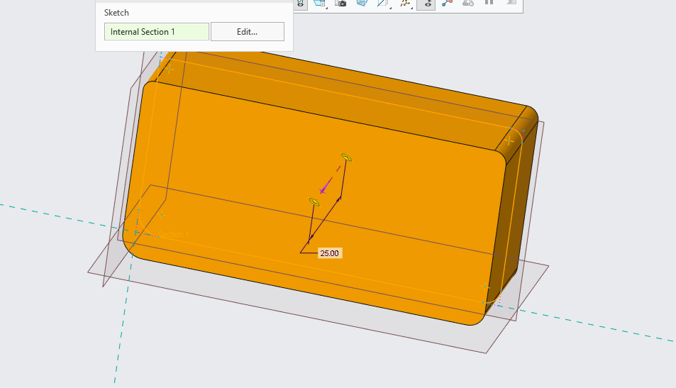
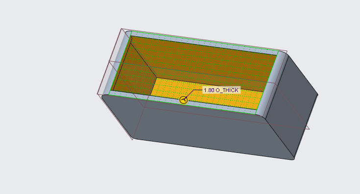
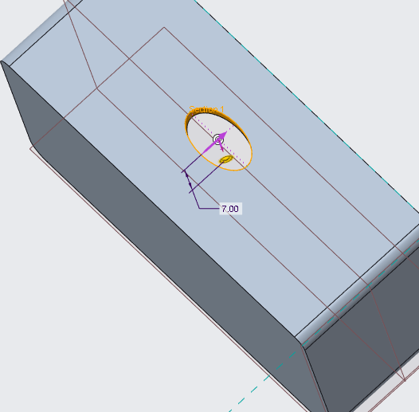
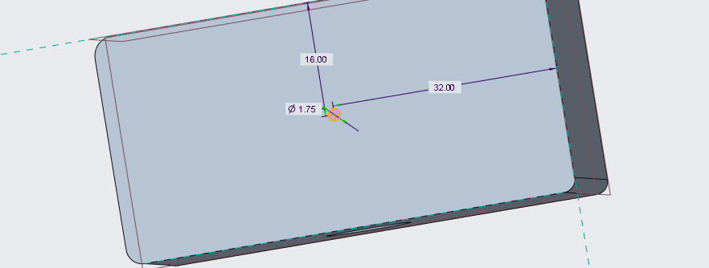
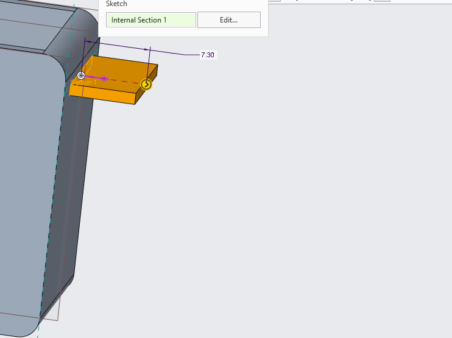
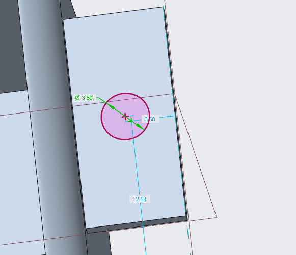
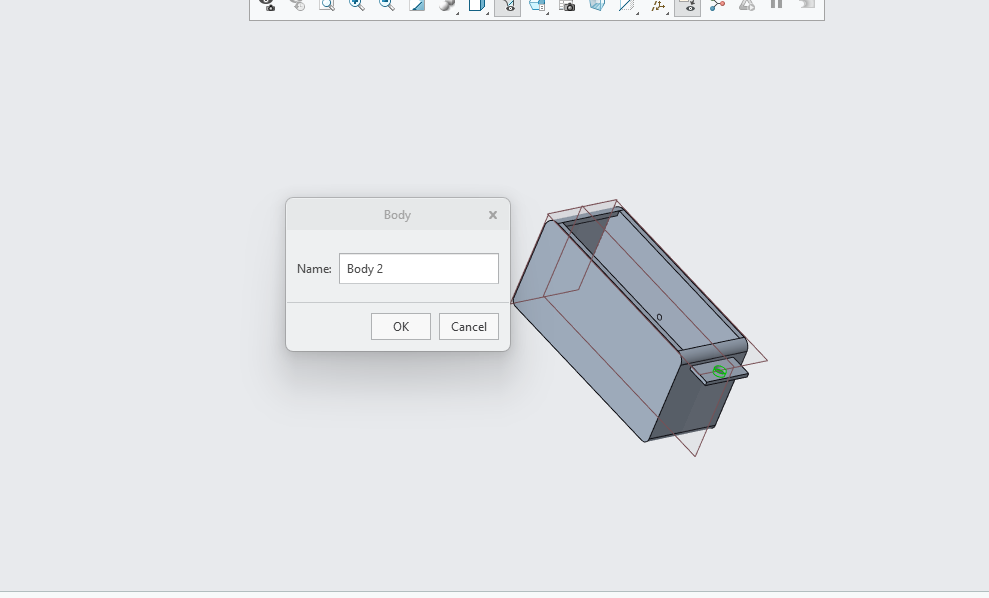

# A8 – Design and Build something useful

## Reading and Writing 

Smart questions are important because they can lead to less design corrections down the line. Asking open ended questions
like what will be the every day use for this product can help designers identify the simple things like the materials
that could be needed or even the size requirements. As well as asking who would be our target audience as the people
whom you are solving the problem for are the most important. I think overall the smarter you make your questions the better you design 
your product. 

## Design

For useful object I decided to create an air pod case as I lost mine and couldn't find one that I liked to replace it, I used this lab as
an opportunity to create one I would like. First I looked online for the nominal diminison of my airpod case and found them for the creo
design. 

To being I started with the bottom part of the airpod case, which will be referred to as __down__ for the rest of this Lab. The length 
and height of down are based on the diminsion on apple.com, I found the width to be 60.6 mm and the height to be around 36 mm 

<figure>
  
  <figcaption><i>Figure 1 Pic: This shows the base of Down.</i></figcaption>
</figure> 

Next to I would go to round the corners of the air pod case so I wouldn't have to deal with the case not matching the design of the 
charging case. 

<figure>
  
  <figcaption><i>Figure 2 Pic: This shows the base of down being rounded.</i></figcaption>
</figure> 

After this I would then go to the sketch press the green arrow and press okay to get to the extrude for my extrude I would create one 
based on symmetry this would allow me to have the same amount of material on both sides of the case. The thickness of this extrude is 1.8
mm based again on apple.com design specifications

<figure>
  
  <figcaption><i>Figure 3 Pic: This shows the base of down being extruded.</i></figcaption>
</figure> 

Finally to finish this figure I would then go to the top of the __down__ to then create the shell so I could actually use the case as
intended. This shell would be the choice here not an extrude as I don't want to remove the bottom of the case yet as I would only cut 
out a small portion of that. 

<figure>
  
  <figcaption><i>Figure 4 Pic: This shows the base of down being shelled.</i></figcaption>
</figure> 

Next after finishing the overall base of the object I would  being to create the charging port for the case. This would be done by 
clicking the bottom of __down__ and then creating an extrude around the middle of the object the exact is about 32 mm in since our 
air pods charging case are only 64 mm long this is where our circle's radius comes from. 

<figure>
  
  <figcaption><i>Figure 5 Pic: This shows the base of down being sketched for the hole.</i></figcaption>
</figure> 

After this I would then create the actual extrude of this hole so the charger can fit into the charging port. 

<figure>
  
  <figcaption><i>Figure 6 Pic: This shows the base of down being extruded for the hole.</i></figcaption>
</figure> 

It was at this point that I remembered that each hole should have an indication so I can know that my charging is done when I need to
charge the case and the airpods. I added this as one of the touch ups as shown below it was an extrude on the front base of the __down__

<figure>
  
  <figcaption><i>Figure 7 Pic: This shows the hole for the charging indication.</i></figcaption>
</figure> 

Next, I would create an option for a lanyard loop to be added to the case my last case had this and I realized how useful it can 
be in design so I added one for this design as well, near the top of __down__ I added a rectangle for the lip of this design
and extruded it as shown below. 

<figure>
  
  <figcaption><i>Figure 8 Pic: This shows the extrude for the loop</i></figcaption>
</figure> 

Continuing on, I would then add another circle inside of this so I could have a place to push the loop through. This would be an
extrusion on the rectangle just created, as shown below. 

<figure>
  
  <figcaption><i>Figure 9 Pic: This shows the extrude for the loop's hole</i></figcaption>
</figure> 

Pushing past, I would then create a new body so I could create the top part of this without having to recreate the different parts and
rounding's for it. Using the body feature in Creo it can inherit the shapes contours thankfully, below is the body being created in creo.

<figure>
  
  <figcaption><i>Figure 9 Pic: This shows the extrude for the loop's hole</i></figcaption>
</figure> 

The body would be created and both parts would be shelled the same so I could continue to prusa slicer. 

## 3D Printing

<ol>
  <li>I used machine number 8.</li>
  <li>I didn't find a use for a raft in my design</li>
  <li>The wall thickness was 0.7 mm</li>
  <li>I used the monotonic Infil because it was the first one I saw I didn't think it mattered too much how it was infilled for this design.</li>
  <li>I had no use for supports on this design</li>
  <li>In my print 160 layers are used</li>
  <li>The layer thickness is about 0.2mm</li>
  <li>In inches 269.24 is the volume of this surface</li>
  <li>I did the layout the way I did because I knew the hole on the bottom would be hard to create from the top so I had the base sit on the bottom with the hole. I thought it would be easier to have the top also sit on the right side up as well.</li>
  <li>In prusa I kept all my settings the same and didn't change anything as I thought everything would be perfect. I kept the material pla as it has a lower buring point than petg which would be needed with so many layers. I kept my infil at 15%, and everything was unchanged I just sliced the gcode and printed.</li>
  <li>The only thing of note for the slice was that my print was at risk of a lot of overhang at the top due to the way the top was being printed.</li>
</ol>

## Lessons Learned
This print taught me a lot more than I realized, when printing I learned that even if you do get the measurements from a trusted
source like apple it is imperative that you double check for yourself. The reasoning for this is that the airpod case was a
tad bit bigger than what apple had placed on its own website which led to a failed print in the beginning. This was also the first 
time I had to create a print while using pla as an important factor as using petg led to a melting mess in the printer. I learned how 
important it is to considered the equipment when designing around my artifacts like the last time. 

The time it took from start to finish was around 6 hours. 

