# L9 – Laser Cut 

## Design - 

The first thing my partner and I did was decided the variables that we would need for our own parts namely the thickness and kerf measurements, as shown below. 

__Thickness__  
When beginning this part my partner and I began by measuring the wood that we were given from three different points. When measuring 
we got values of 0.10,0.12, 0.10, we got an average value of 0.1117 inches for our piece of wood, as shown below by the pictures of 
the measuring values. The value of 0.117 would now end up being our material thickness variable in the cad parameters. 

__Kerf measurement__   

When putting in a 12 by 12 mm square into the laser cutter, we got a final kerf measurement of 0.009 in, as this was the difference 
in size from the part in our cad and the part when cut with the laser. 

First we added the 12 by 12 square to solid works.  
<figure>
  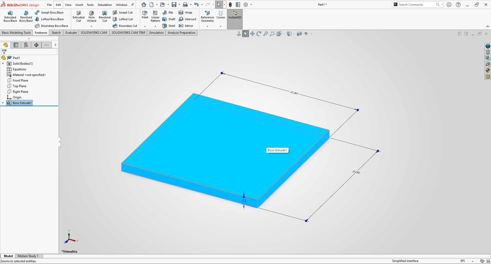
  <figcaption> Showing the first kerf test</figcaption>
</figure>    

Next we would put this into a pdf to be laser cut, as shown below. 

<figure>
  
  <figcaption> Showing the second kerf test file</figcaption>
</figure>    

Last we would cut out this square and test how far off it is. Below is a video of the kerf being laser cut out 

 <figure>
  <video controls width="500" height="500">
    <source src="Kerf_cutting.mp4" type="video/mp4">
    Your browser does not support the video tag.
  </video>
</figure>  

After we cut it we just had to measure it as shown below this is our kerf value of 0.004. 

  
  <figcaption> Showing the offset of the wood to the first measurement</figcaption>
</figure>    

After this we could finally being to create our gear ratio. 

First we added the parameters in cad to begin the parametric modeling as shown below. 
<figure>
  
  <figcaption> Showing the first parametric decisions</figcaption>
</figure>    

Next we would begin by creating the size of the base of our part which would be 4 by 3 inches as shown below,

<figure>
  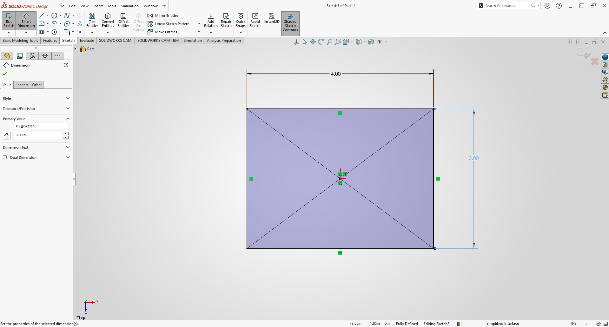
  <figcaption> Showing the bases width and length</figcaption>
</figure>  

After this we would extrude this base to the desired height already chosen by the thickness of wood in our parametric equation, 

<figure>
  
  <figcaption> Showing the extrude</figcaption>
</figure>  

Because we decided to do a gear ratio in our parts the first thing we would do is to create two different holes with same diameters, the
distance from the center was chosen by the parametric modeling. 

<figure>
  
  <figcaption> Showing the differeing holes</figcaption>
</figure>  

Next we would start on the two differing gears, first we would create a gear smaller gear with a diameter of .88, to do this we would 
with a small circle, inside that circle we would design the fit for the shafts to sit in so the gears can turn. This is shown below.

<figure>
  
  <figcaption> Showing the small gears creation in 2d</figcaption>
</figure>  

As we can't design anything in 2d we would need to extrude this part which will be shown below. 

<figure>
  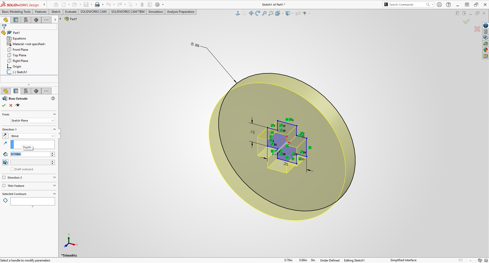
  <figcaption> Showing the small gears extrusion</figcaption>
</figure>  

Using solid works we're able to create a pattern on the edge of the same circle that can be later cut to be a complete gear, this can be
seen in the image below. 

<figure>
  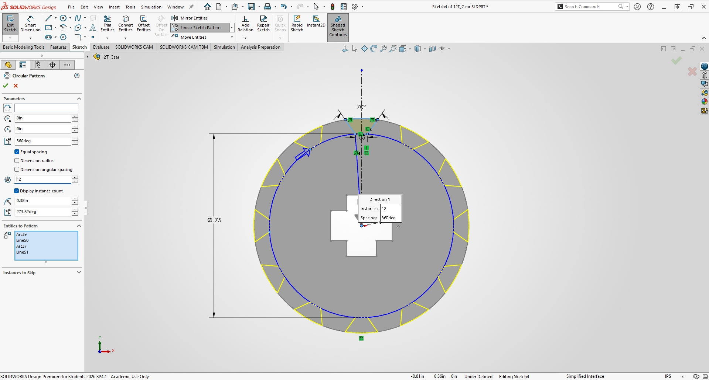
  <figcaption> Showing the small gears pattern</figcaption>
</figure> 

The complete smaller gear. 

<figure>
  
  <figcaption> Showing the small gear</figcaption>
</figure> 

From the smaller gear we can create the larger gear in the same way, we can create a copy of this part and then edit the dimensions so 
no need to completely recreate the part. Below you can see the changing of the diameter from 0.88 to almost double at 1.63 as well as 
a change of the shaft fit diameter to fit the bigger size.

<figure>
  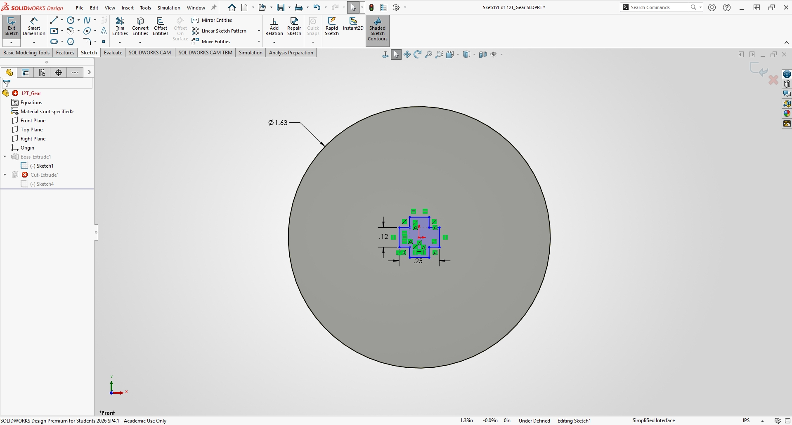
  <figcaption> Showing changing to a larger gear</figcaption>
</figure> 

Next, we would have to change the pattern as again we'd have to size them up to fit inside the larger gear, as shown below the pattern is 
changed. 

<figure>
  
  <figcaption> Showing changing to a larger gear pattern</figcaption>
</figure> 

As the thickness is also parametrically designed we don't need to change anything there and the final larger gear can be shown below. 

<figure>
  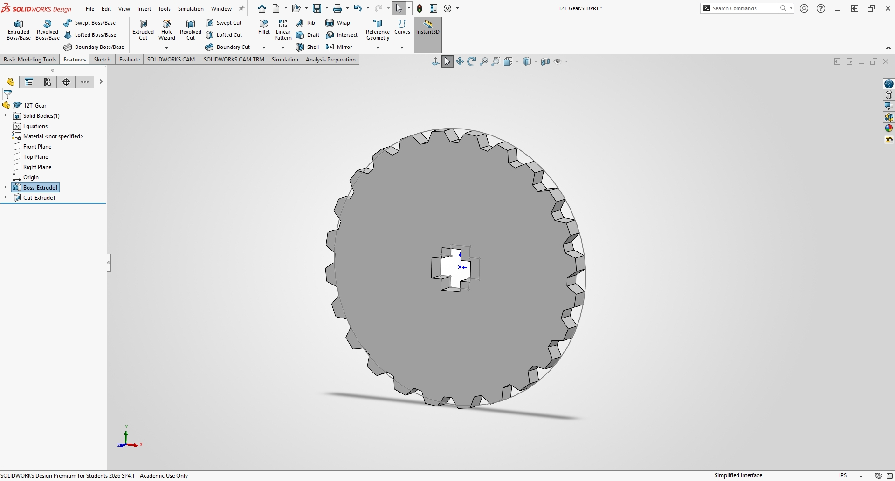
  <figcaption> Showing finshed larger gear</figcaption>
</figure> 

Next we would have to begin the designing of the shafts for the two separate gears. The values for the the shafts are chosen by the inner
shafts by the two gears we previously created as shown below. 
<figure>
  
  <figcaption> Showing the start of the  shaft</figcaption>
</figure> 

Next, we would extrude this part as shown below. 

<figure>
  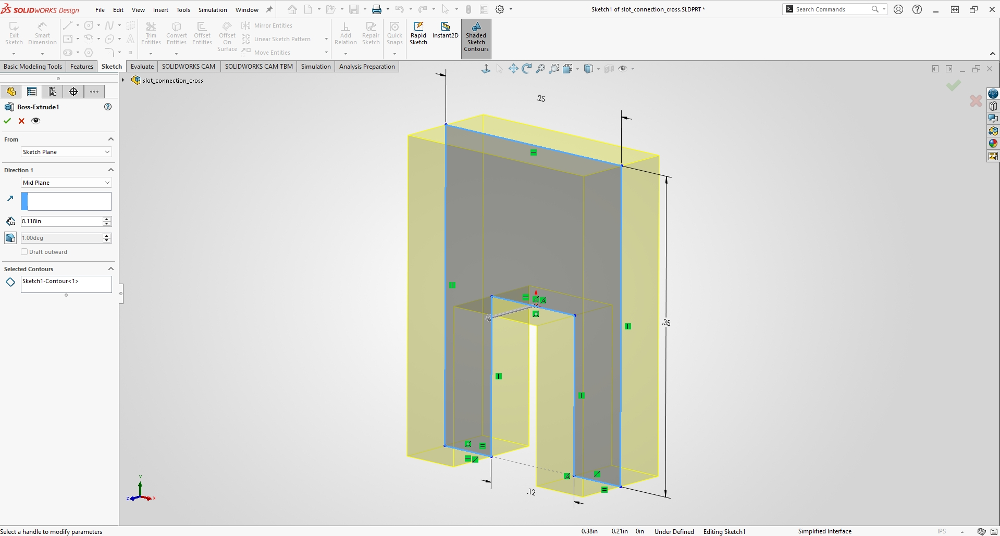
  <figcaption> Showing the shaft extrusion</figcaption>
</figure> 

The next things we're doing is creating holes that fit the original cut outs on the plate so we could slot those in for our shafts to 
flow without creating friction. We would create a hole with the dimeter we had in the original two holes on the sitting plate, then add
the values for the shaft in the middle similar to the gear as shown below. 

<figure>
  
  <figcaption> Showing the first slotting hole</figcaption>
</figure> 

Next we would use the parametric thickness to extrude this part, as shown below. 

<figure>
  
  <figcaption> Showing the first slotting hole extrude</figcaption>
</figure> 

Afterwards we would being to assemble the parts together to get a feel of how they should fit in the final design, starting with the 
shafts and constraining it. 

<figure>
  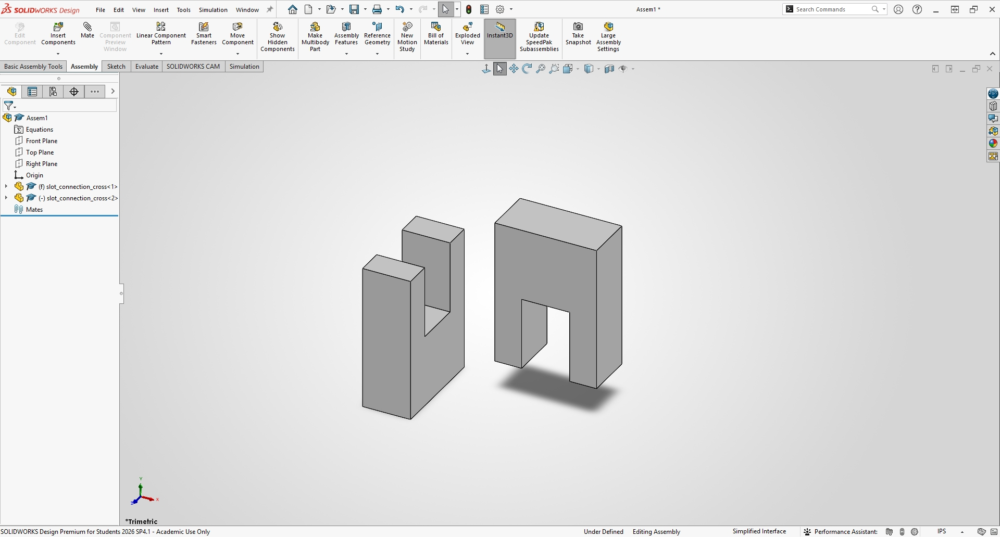
  <figcaption> Showing the shafts fitting together pt1</figcaption>
</figure> 

<figure>
  
  <figcaption> Showing the shafts fitting together pt2</figcaption>
</figure> 

<figure>
  
  <figcaption> Showing the shafts fitting together pt3</figcaption>
</figure> 

<figure>
  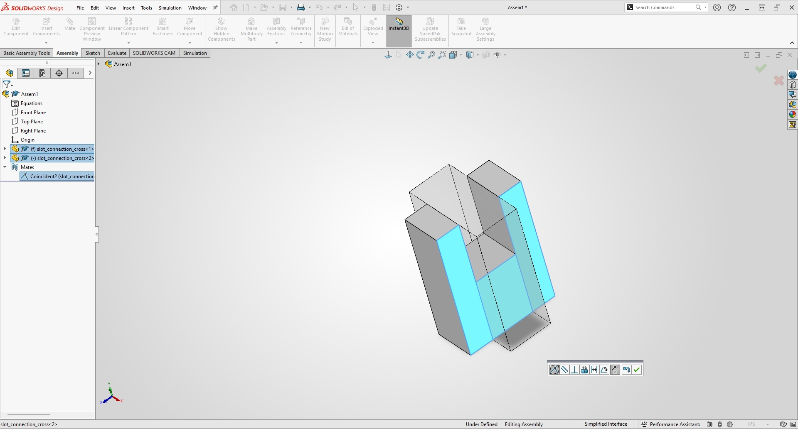
  <figcaption> Showing the shafts fitting together pt4</figcaption>
</figure> 

<figure>
  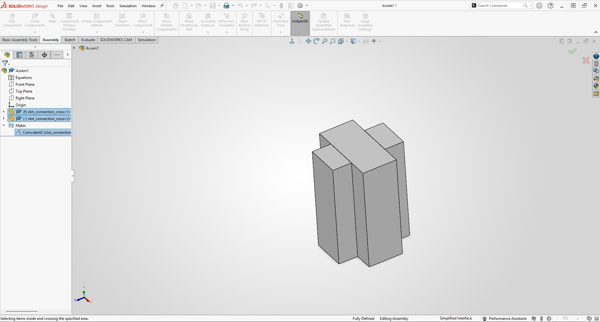
  <figcaption> Showing the shafts fitting together pt5</figcaption>
</figure> 

Next, we would put these on the plate and check how it fits together first we have to add these parts, starting with our plate, 
and creating a new assembly.

<figure>
  
  <figcaption> Showing the start of the final assembly </figcaption>
</figure> 

Next we would have to slot in the holes that translate the rotation from the shafts to the gears. 

<figure>
  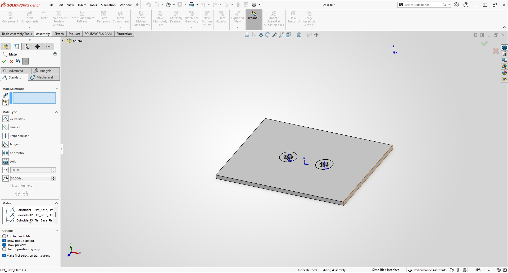
  <figcaption> Showing the holes being slotted in </figcaption>
</figure> 

Afterwards we add our actual shafts, 

<figure>
  
  <figcaption> Showing the shafts being added</figcaption>
</figure> 

Then the driver gear, 

<figure>
  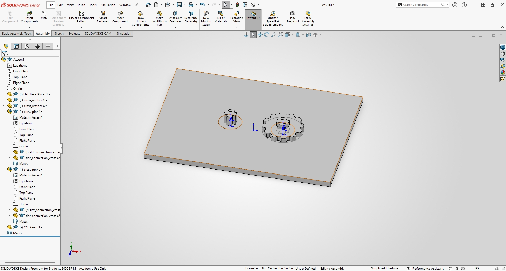
  <figcaption> Showing the driver being added</figcaption>
</figure> 

Lastly the secondary gear, 
<figure>
  
  <figcaption> Showing the last gear being added and finishing the assembly</figcaption>
</figure> 

__Parameter Data__ 

<table>
<tr>
  <th> 
    Variable Name
  </th>
  <th>
    Value (in)
  </th>
  <th>
    Unit Source (measured or chosen) 
  </th>
  <th>
    What it controls  
  </th>
</tr>

<tr>
  <td>Thickness</td>
  <td>0.1117</td>
  <td>Measured (Step 1)</td>
  <td>The thickness of the material </td>
</tr>

<tr>
  <td>Kerf</td>
  <td>0.009</td>
  <td>Measured (Step 2)</td>
  <td>The amount of material blown away by the laser</td>
</tr>

<tr>
  <td>Clearance</td>
  <td>0.002</td>
  <td>Chosen (Step 4)</td>
  <td>This controls how tight the parts will be too each other</td>
</tr>

<tr>
  <td>Slot width</td> 
  <td>0.5 radius</td>
  <td>Chosen</td>
  <td>This controls how large the holes created to slot in the plates are</td>
</tr>

<tr>
  <td>Hole's Distance</td>
  <td>1.125</td>
  <td>Chosen</td>
  <td>This controls the distance of holes for the base plate</td>
  
</tr>

</table>

## Manufacturing/Process Research

__Paragraphs__ 

Laser cutting works by using a high powered computer controlled laser beam through optics to melt and burn away at a chosen material, 
while an auxiliary gas blows away at any debris left. This is a viable manufacturing process because it is extremely accurate, rapid 
production cycles and very smooth finishes without need for another tool. 

We can compare laser cutting to 3d printing in a sense, laser cutting unlike the additive manufacturing of 3d printing is very quick 
which is perfect for mass production. Another benefit of laser cutting is it is more versatile, as most materials can be cut out through
laser cutting unlike 3d printings filaments. When a company may need materials with differing structural materials laser cutting is the 
best option. Lastly the control laser cutting gives you is also better than the typical Fdm printing we've been using as we can create 
more variables for a more custom fitting part. 

__Photos__

After designing the parts in solid works we created a drawing and then uplodaded that drawing as a pdf to be used to upload to the laser
cutter as shown below. 

<figure>
  
  <figcaption> Showing the parts in solidwords drawing</figcaption>
</figure> 

<figure>
  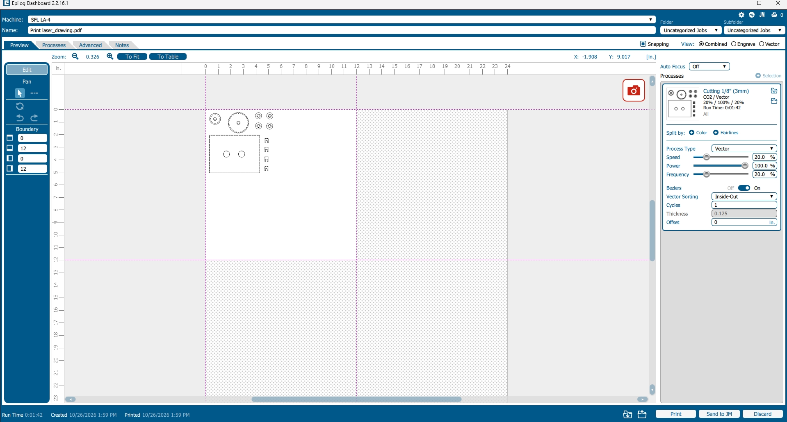
  <figcaption> Showing the parts in pdf file uploaded to laser printing software</figcaption>
</figure> 

__Video__

__Laser Process Record__
<table> 
  <th>Setting</th>
  <th>Kerf Coupon</th>
  <th>Cut</th>

<tr>
  <td>Laser Cutter Number</td>
  <td>1</td>
  <td>1</td>
</tr>

<tr>
  <td>Material type</td>
  <td>Wood</td>
  <td>Wood</td>
</tr>

<tr>
  <td>Nominal thickness</td>
  <td>1/8 in</td>
  <td>1/8 in</td>
</tr>

<tr>
  <td>Measured thickness (mean, in)</td>
  <td>1.117</td>
  <td>1.117</td>
</tr>

<tr>
  <td>Speed</td>
  <td>20%</td>
  <td>20%</td>
</tr>

<tr>
  <td>Power</td>
  <td>100%</td>
  <td>100%</td>
</tr>

<tr>
  <td>Frequency</td>
  <td>20%</td>
  <td>20%</td>
</tr>

<tr>
  <td>Number of passes</td>
  <td>4</td>
  <td>1</td>
</tr>

<tr>
  <td>Focus method and how confirmed it	</td>
  <td>Auto focus | confirmed by Lowered the laser head until the spacer block slid snugly between the nozzle tip and the top surface of the measured material sheet without pinching </td>
  <td>Auto focus | confirmed by Lowered the laser head until the spacer block slid snugly between the nozzle tip and the top surface of the measured material sheet without pinching </td>
</tr>

<tr>
  <td>Air assist on? Exhaust on?</td>
  <td>Yes | Yes </td>
  <td>Yes | Yes </td>
</tr>

<tr>
  <td>How you set origin and alignment</td>
  <td>Top-left corner of sheet using laser pointer jog</td>
  <td>Top-left corner of sheet using laser pointer jog</td>
</tr>

</table>

__Air assist and Exhaust observations__ 

While laser cutting my partner and I noticed how quickly the potential fires from the prints were dissipated. While the high powered laser cut the 
wood, the air extinguished the fires that came about. We noticed how even after the print was done though a smell persisted, no matter how big or 
small the print was there the smell of burning wood stayed. 

__Edge Quality__ 

We can see how the edges are very high quality you can see the burns on the outlines of the gear. This was an expected outcome as the laser burns 
away at the wood, there wouldn't be anyway to improve this, as the laser has to cut this way. 

## Lessons Learned 

