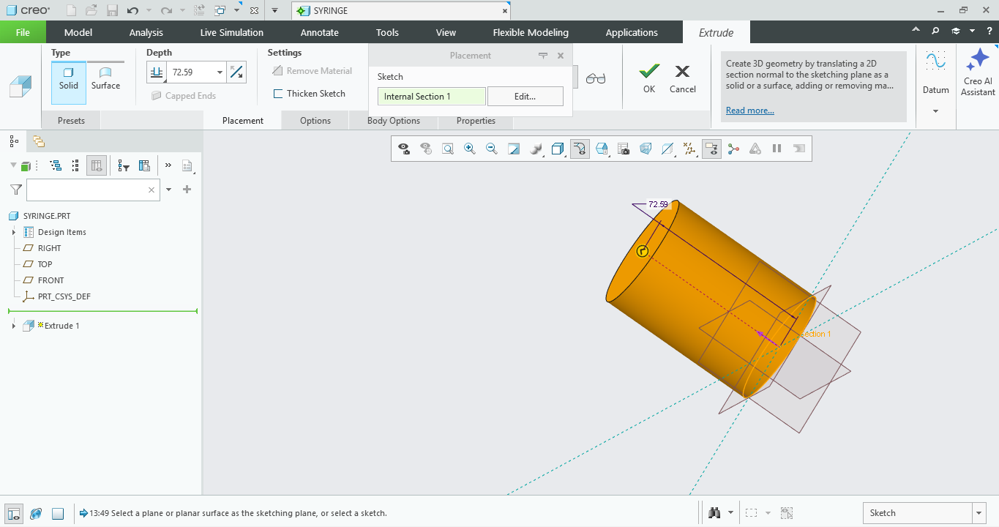
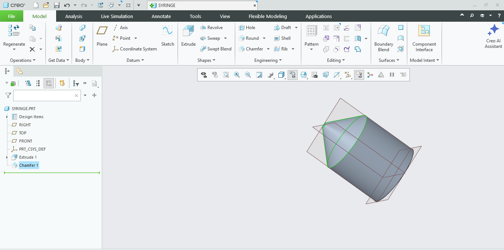
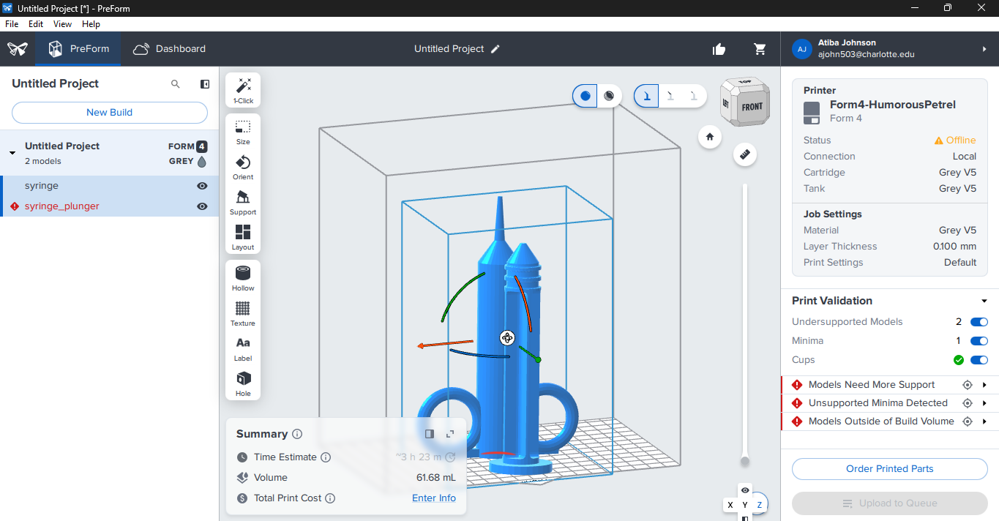
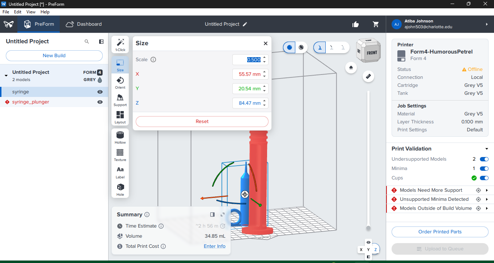
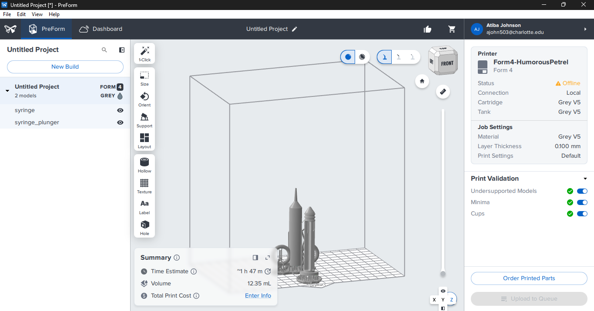

## L10 RC2 - Sliding Fit and Design Verification 

## Research And Planning 

According to the Machinery’s Handbook, Class RC 2 Sliding Fits are intended for accurate location of parts that must assemble without perceptible play while 
remaining easy to move and turn. Unlike running fits, they are not designed for continuous high-speed rotation and can be sensitive to minor thermal expansion
in larger sizes.

For our tolerance range we selected a hole tolerance of +0.3 to ) and  shaft of -0.15 to -0.35. Our snap fit could be useful in the alignment and locating pin
mechanism used in modular manufacturing jigs and assembly fixtures. In a production cell, such a fit ensures repeatable positioning of interchangeable tooling 
plates without side-to-side play while allowing quick manual insertion and removal by operators.

SLA resin prints typically experience volumetric shrinkage during UV post-curing (often resulting in slightly undersized holes and oversized exterior pins).
In order to counteract polymerization shrinkage we had to create a larger offset for our shafts and holes. 

 ## Application & Creative Artifact Concept

To move beyond a plain cylinder-and-hole test coupon while staying well within the 20 mL resin volume cap, I designed a Two-Part Precision Dispensing Syringe 
(Part A: graduated syringe barrel with finger flanges and a tapered dispensing nozzle; Part B: matching plunger piston with a thumb pad and alignment guide 
ribs). Real-world applications of RC 2 sliding fits include precision fluid/adhesive dispensing syringes, metering plungers, locating pins in assembly jigs, 
and telescoping instruments where smooth manual travel and accurate concentric alignment prevent cocking, binding, or inconsistent dosing.

## Cad Design (Part A) 

I started with a 0.5000 circle to be the in inner barrel bore and mating plunger piston land diameter (with a 2.25 in barrel stroke length 
and 0.075 in wall thickness to  keep total resin volume under ~10–14 mL). As shown below  

<figure>
  
  <figcaption> Showing the first screenshot</figcaption>
</figure>    

Afterwards I shelled the outside to create a conic point as shown below, this creates a better syringe look. 

<figure>
  
  <figcaption> Showing the second screenshot</figcaption>
</figure>   

Then we I created another circle and extruded it again as shown below, just long and wide enough to fit inside of the shelled first hole. 

<figure>
  
  <figcaption> Showing the third screenshot</figcaption>
</figure> 

Next I had to create the same conic look with the shell feature as shown below. 

<figure>
  
  <figcaption> Showing the forth screenshot</figcaption>
</figure> 

## Preprocessing 

Next I put our two parts into the resin Preform as shown below 

<figure>
  
  <figcaption> Showing the fifth screenshot</figcaption>
</figure> 

I noticed the prints were too big and didn't fit the required 20ml so below is me changing it. 

<figure>
  
  <figcaption> Showing the sixth screenshot</figcaption>
</figure> 

Next I fixed the supports on the objects so they could print 

<figure>
  
  <figcaption> Showing the sixth screenshot</figcaption>
</figure> 

## Printing process

 

## Postprocessing 
<ul>
  <li>Washing: Cleaned in Isopropyl Alcohol (IPA > 99%) for 10 minutes in an automated wash station to strip unpolymerized surface resin.  </li>
  <li>Support Removal: Supports carefully snipped flush with diagonal cutters prior to UV curing to prevent localized stress marks on precision faces.  </li>
  <li>Curing: Post-cured in a UV chamber at 60°C for 15 minutes. </li>
  <li>Surface Finish & Inspection: Surfaces exhibited smooth matte finishes.</li>
  <li>No visible warping  was observed across the primary sliding surfaces.</li>
</ul>

## Fit test

## Lessons Learned

<ul>
  <li>A challenge we had was for accounting for resin shrinkage across enclosed internal bores versus exterior pins required iterative offset testing. Initial test prints without shrinkage compensation resulted in slight interference. One thing we learned was the need for the chafers on the part as it allowed the 
  part to endure higher stresses. ~3.5 hours (CAD modeling & tolerance stack-up: 1.5 hrs; Slicing/Printing: 2.0 hrs)</li>
</ul>

## Analyze

## Decide
_Reference your concept selection (Pugh matrix) here. How does this design follow from that decision?_

## Communicate

