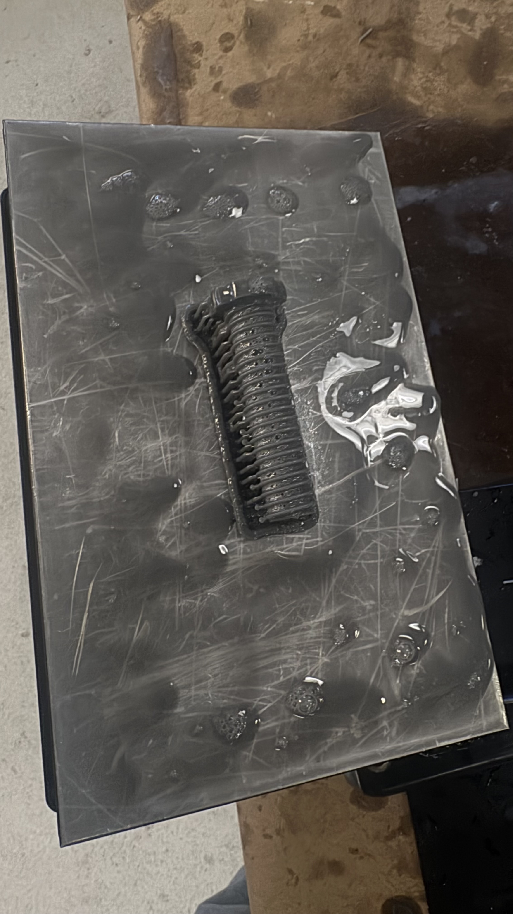

# Final Project – [Headphone Holder]

## Objectives

For my design I wanted to create something that could free up more space on my desk so I decided to create a headphone holder.
I did this because the headphones on my desk create the biggest problems with my own storage space and this is a problem, I've noticed
with a lot of people who play games often. 

## Problem to Solve
 - More space on the desk
 - Not adding anything that can be just thrown away
 - Works with my desk
 - Holds all weights of headphones 

## Part 1

## Cad Design for the first part 

I started with creating a basic shape of the holder using the outline of my desk as a reference as shown below, 

<figure>
   Showing the first screenshot</figcaption>
</figure> 

Next I would extrude this shape and cut a hole in the center point to allow for the screw and thread to be inserted as shown below,

<figure>
   Showing the first screenshot</figcaption>
</figure> 

Finally I would go to print this lead screw in FDM and the placement in SLA the videos are shown below, 

<figure>
   Showing the first screenshot</figcaption>
</figure> 

<figure>
  <video controls width="500" height="500">
    <source src="resinprint.mp4" type="video/mp4">
    Your browser does not support the video tag.
  </video>
</figure>  

## Feedback 

The Feedback I would get is shown below:

<ul>
 <li> Doesn't work on everydesk</li>
 <li> The screw is too slow for it to be practical</li>
</ul>

## Part 2

For the second go around I would create a thread that can be taken apart to fix the threading issue as shown below

I would also make the distrubtion of everything larger so I wouldn't have to worry about desk size anymore the final build can be 
shown below.

## Lessons Learned: 

I learned how hard it can be to create something to design specifications. The entire class has been just creating things we want to create
but trying to create things to fit what a customer can want can be a challenge that I understand now. I also learned how much of a pain it
can be to try to reprint something in the resin. This was only my third time using resin and I had to keep recreating the screw as it would
only recognize it as a cup and that was a problem throughout the entire final project. I was able to fix the issue by upping the print speed
but it would still lead to small little cracks at times.

## Total Project time 

- Rough Idea : 4 hours
- Cad Design : 2 hours
- Printing : 3 Hours
- Revisons : 5 hours
- Printing Change : 5 Hours
- Total time : 19 hours 
